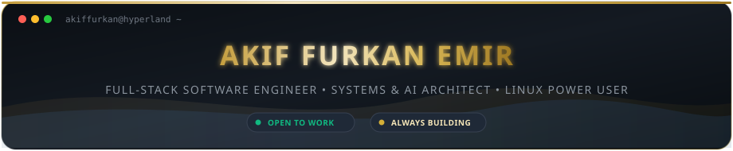

<div align="center">

<!-- Self-Hosted Luxury Hyprland & Gold SVG Header -->


<p align="center">
  
</p>

<p align="center">
  <a href="https://github.com/akiffurkan">
    
  </a>
  
  
</p>

</div>

---

## 🌌 The Mindset & Philosophy

```
  ┌────────────────────────────────────────────────────────────────────────┐
  │  "Talk is cheap. Show me the code."                 — Linus Torvalds   │
  │  "Simplicity is prerequisite for reliability."      — Edsger Dijkstra  │
  │  "Build → Break → Understand → Optimize"            — AF               │
  └────────────────────────────────────────────────────────────────────────┘
```

> 💡 *Passionate about building fast, reliable, and aesthetically pleasing software. Whether it's crafting system-level utilities, architecting full-stack web applications, or designing bespoke dark & gold user experiences, I focus on clean architecture, relentless optimization, and engineering that lasts.*

---

<h2 align="center">🧠 TECH STACK</h2>

<div align="center">

<p style="margin: 4px 0 2px 0;"><b>Languages</b></p>
<a href="https://skillicons.dev"></a>

<p style="margin: 6px 0 2px 0;"><b>Frontend & UI</b></p>
<a href="https://skillicons.dev"></a>

<p style="margin: 6px 0 2px 0;"><b>Backend & Cloud</b></p>
<a href="https://skillicons.dev"></a>

<p style="margin: 6px 0 2px 0;"><b>Game, 3D & Creative</b></p>
<a href="https://skillicons.dev"></a>

<p style="margin: 6px 0 2px 0;"><b>Database & Storage</b></p>
<a href="https://skillicons.dev"></a>

<p style="margin: 6px 0 2px 0;"><b>DevOps, Hardware & Tools</b></p>
<a href="https://skillicons.dev"></a>

<p style="margin: 6px 0 2px 0;"><b>Platforms & Operating Systems (Active)</b></p>
<a href="https://skillicons.dev"></a>

<p style="margin: 6px 0 2px 0;"><b>Past Platforms & Distro Experience</b></p>
<a href="https://skillicons.dev"></a>

</div>

---

<h2 align="center">⚡ Featured Projects</h2>

<div align="center">

<table align="center" width="100%">
  <tr>
    <td width="33.33%" valign="top">
      <h3 align="center">📱 <a href="https://github.com/akiffurkan">Antigravity Mobile</a></h3>
      <p align="center">
        <b>Mobile Companion for Autonomous AI Agents</b>
      </p>
      <ul>
        <li>🤖 Monitor and control autonomous agents on the go.</li>
        <li>📡 Live telemetry, execution logs streaming & workspace browser.</li>
        <li>💎 Cyberpunk glassmorphic UI with push notifications.</li>
        <li>⚡ Remote task dispatching & subagent lifecycle management.</li>
      </ul>
      <p align="center">
        <code>Mobile</code> • <code>Tauri / Flutter</code> • <code>AI Companion</code>
      </p>
    </td>
    <td width="33.33%" valign="top">
      <h3 align="center">⌚ <a href="https://github.com/akiffurkan/hwt-lister">HWT Lister</a></h3>
      <p align="center">
        <b>Haute Horlogerie Huawei Watch Face Gallery</b>
      </p>
      <ul>
        <li>👑 Luxury White & Gold single-file web gallery.</li>
        <li>🔍 Real-time search, multi-sorting & XML metadata inspection.</li>
        <li>🛡️ Smart cover extraction with AMOLED AOD protection.</li>
        <li>⚡ Zero-setup single-command Python Flask execution.</li>
      </ul>
      <p align="center">
        <code>Python</code> • <code>Flask</code> • <code>Pillow</code> • <code>Luxury UI</code>
      </p>
    </td>
    <td width="33.33%" valign="top">
      <h3 align="center">🖥️ <a href="https://github.com/akiffurkan">Codenotch for Windows</a></h3>
      <p align="center">
        <b>Desktop Coding Assistant & Provider Activity Hub</b>
      </p>
      <ul>
        <li>📊 Real-time monitoring of AI coding tokens & model providers.</li>
        <li>⚡ Native high-performance desktop integration.</li>
        <li>🦀 Minimal memory footprint with Rust & Tauri backend.</li>
        <li>📦 Distributed as Portable, Setup, and Source.</li>
      </ul>
      <p align="center">
        <code>Rust</code> • <code>Tauri</code> • <code>Windows API</code> • <code>AI Tools</code>
      </p>
    </td>
  </tr>
  <tr>
    <td width="33.33%" valign="top">
      <h3 align="center">🚇 Metrom Nerede (Deprecated)</h3>
      <p align="center">
        <b>Modern Istanbul Public Transit Experience</b>
      </p>
      <ul>
        <li>📍 Live nearest station finder & estimated arrivals.</li>
        <li>🚇 Metro, Tramway, Metrobüs & Bus line status tracking.</li>
        <li>💎 Polished glass-inspired UI designed for swift one-hand access.</li>
      </ul>
      <p align="center">
        <code>Cross-Platform</code> • <code>Modern UI</code> • <code>Geolocation API</code>
      </p>
    </td>
    <td width="33.33%" valign="top">
      <h3 align="center">⚡ <a href="https://github.com/akiffurkan/PulseNode">PulseNode</a></h3>
      <p align="center">
        <b>Next-Gen Server & Docker Telemetry</b>
      </p>
      <ul>
        <li>📊 Real-time CPU, RAM, Disk & Network telemetry over SSH.</li>
        <li>🐳 Docker container orchestrator & live interactive shell.</li>
        <li>🔍 Deep hardware profiler, SMART disk health & PCIe details.</li>
        <li>🧠 AI bottleneck advisor & system boot failure diagnostics.</li>
      </ul>
      <p align="center">
        <code>Flutter</code> • <code>SSH / SFTP</code> • <code>Docker</code> • <code>AI Engine</code>
      </p>
    </td>
        <td width="33.33%" valign="top">
      <h3 align="center">📱 <a href="https://github.com/akiffurkan/hwt-lister-mobile">HWT Lister Mobile</a></h3>
      <p align="center">
        <b>Haute Horlogerie Huawei Watch Face Client</b>
      </p>
      <ul>
        <li>👑 Luxury Dark Obsidian & Cream Gold native Flutter UI.</li>
        <li>📂 Direct <code>/Huawei</code> storage scanning, file import & share.</li>
        <li>🛡️ Smart cover extraction, AMOLED AOD toggle & XML inspector.</li>
        <li>🌍 7-language localization with full dynamic RTL support.</li>
      </ul>
      <p align="center">
        <code>Mobile</code> • <code>Flutter</code> • <code>Huawei HWT</code> • <code>Luxury UI</code>
      </p>
    </td>
  </tr>
  <tr>
    <td width="33.33%" valign="top">
      <h3 align="center">🍎 <a href="https://github.com/akiffurkan/Huawei-MateBook-D16-Hackintosh-Guide">Huawei MateBook D16</a></h3>
      <p align="center">
        <b>macOS Sonoma / Sequoia / Tahoe Hackintosh Guide</b>
      </p>
      <ul>
        <li>⚡ Intel Core i9-13900H (14C/20T) hybrid scheduler tuned.</li>
        <li>🔋 Full battery management & Intel Wi-Fi 6 AX201 native.</li>
        <li>🛠️ Custom SSDT-TPD0 ACPI bridge for FocalTech I2C trackpad.</li>
        <li>📖 Comprehensive bilingual (English & Türkçe) documentation.</li>
      </ul>
      <p align="center">
        <code>Hackintosh</code> • <code>OpenCore</code> • <code>macOS</code> • <code>EFI Guide</code>
      </p>
    </td>
    <td width="33.33%" valign="top">
      <h3 align="center">🚀 Coming soon...</h3>
      <p align="center">
        <b>New Project in Development</b>
      </p>
      <ul>
        <li>✨ Exciting open-source software in development.</li>
        <li>💡 Modern architecture & slick user experience.</li>
        <li>📡 Next-gen tooling and automated workflows.</li>
      </ul>
      <p align="center">
        <code>In Progress</code> • <code>Stay Tuned</code>
      </p>
    </td>
    <td width="33.33%" valign="top">
      <h3 align="center">🚀 Coming soon...</h3>
      <p align="center">
        <b>New Project in Development</b>
      </p>
      <ul>
        <li>✨ Exciting open-source software in development.</li>
        <li>💡 Modern architecture & slick user experience.</li>
        <li>📡 Next-gen tooling and automated workflows.</li>
      </ul>
      <p align="center">
        <code>In Progress</code> • <code>Stay Tuned</code>
      </p>
    </td>
  </tr>
</table>

</div>

---

<h2 align="center">⚙️ Hardware & Battle Station</h2>

<div align="center">

<table align="center" width="100%">
  <tr>
    <td width="50%" valign="top">
      <h3 align="center">💻 Primary Workstation</h3>
      <p align="center"><b>Huawei MateBook D16 (2024) 16"</b></p>
      <ul>
        <li><b>CPU:</b> Intel® Core™ i9-13900H (14C / 20T)</li>
        <li><b>RAM:</b> 16 GB LPDDR4X</li>
        <li><b>Storage:</b> 1 TB M.2 NVMe SSD</li>
        <li><b>GPU:</b> Intel® Iris® Xe Graphics (iGPU)</li>
        <li><b>OS:</b> Windows 11 26H2 & macOS Sonoma / Sequoia <i>(Dual-Boot)</i></li>
      </ul>
      <p align="center">
        <code>Daily Driver</code> • <code>Dev Workstation</code> • <code>High Performance</code>
      </p>
    </td>
    <td width="50%" valign="top">
      <h3 align="center">🖥️ Home Lab & Server</h3>
      <p align="center"><b>Dedicated Ubuntu Server Node</b></p>
      <ul>
        <li><b>CPU:</b> Intel® Core™ i7-4790K (4C / 8T)</li>
        <li><b>RAM:</b> 16 GB DDR3</li>
        <li><b>Storage:</b> 2x 1 TB HDD + 240 GB SSD (2.24 TB)</li>
        <li><b>GPU:</b> NVIDIA GeForce G210 <i>(Display Output)</i></li>
        <li><b>OS:</b> Ubuntu 26.04.1 LTS</li>
      </ul>
      <p align="center">
        <code>Homelab</code> • <code>24/7 Server</code> • <code>Self-Hosted Infrastructure</code>
      </p>
    </td>
  </tr>
  <tr>
    <td colspan="2" align="center">
      📱 <b>Mobile Device:</b> Samsung Galaxy A04e &nbsp;•&nbsp; ⚡ <b>Ecosystem:</b> Tailored for high-throughput coding & remote server automation
    </td>
  </tr>
</table>

</div>

---

## 📊 Developer Metrics & GitHub Analytics

<div align="center">

<!-- GitHub Stats & Top Languages -->

&nbsp;


<br/><br/>

<!-- Streak Stats -->


</div>

---

## 💬 Inspiring Developer Quotes

<div align="center">
  
</div>

---

<div align="center">

### 🤝 Let's Connect & Collaborate

<p align="center">
  <a href="https://github.com/akiffurkan">
    
  </a>
</p>

<p align="center">
  <sub>⭐ Designed with passion & precision by <b>Akif Furkan Emir</b></sub>
</p>

</div>
